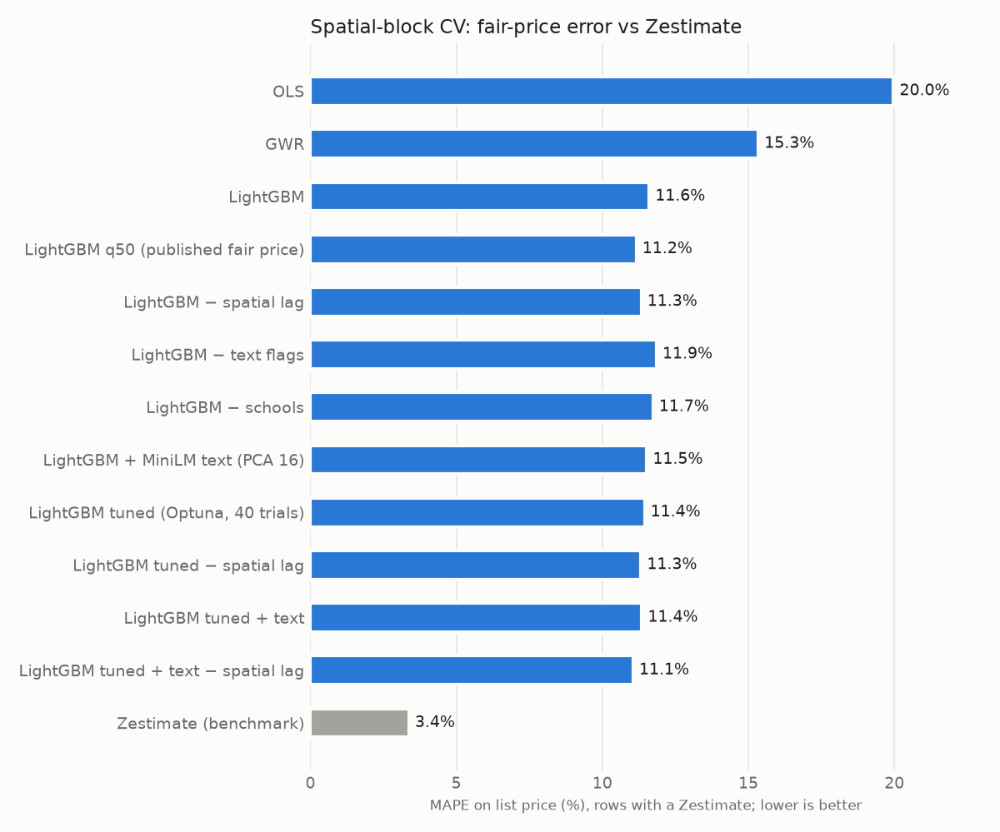
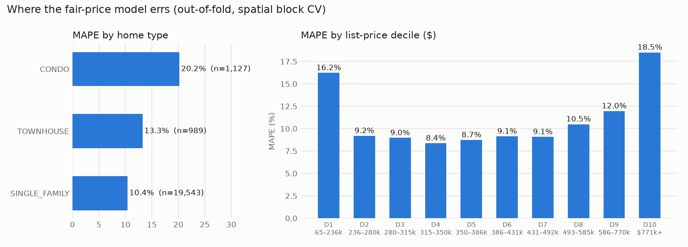
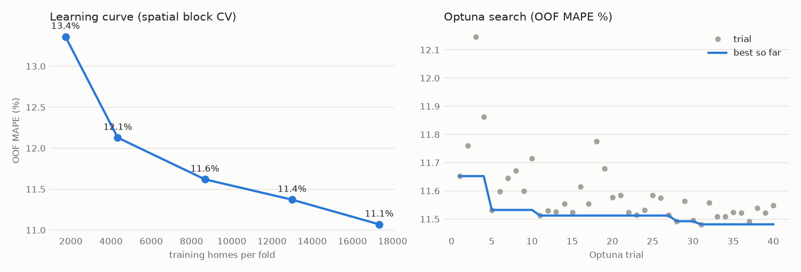

# Houston Housing "Price Receipt": a single-listing due-diligence report

UH AI Hackathon, Track 2. For any Houston listing, we answer **three separate questions** with
evidence and no invented confidence scores. Where evidence is missing, the answer is `"unknown"`.

1. **Is the asking price reasonable?** We give a calibrated 80% fair-price range (q10–q90), a
   verdict (*low* / *expected* / *high*), an itemized **price receipt** that sums to the fair
   price, and 8 comparable listings.
2. **Does the listing check out?** Verification signals (`ok` / `warning` / `unknown`), each with
   its evidence: asking far below the range, photos or descriptions reused by a *different*
   broker, missing agent or broker attribution, size inconsistent with nearby homes, and
   page-view vs. days-on-market anomalies.
3. **What will it cost per month?** Mortgage (the listing's Zillow 30-yr rate, 20% down),
   property tax and HOA. Insurance is `"unknown"`. Every assumption and unknown is listed.

An LLM agent (Qwen3-32B on Featherless) can run any of this through tools and return maps,
charts and reports.

## Setup, deployment and current status (read this first)

### Architecture

```
browser ──https──▶ quanthouse.casa (Fly.io app "quanthouse", 1 machine, dfw)
                   ├─ Next.js frontend  :8080 public    frontend/   (Saleh)
                   │    /api/*      → adapter routes, proxy to FastAPI
                   │    /backend/*  → raw FastAPI (rewrite; used for local frontend dev)
                   └─ FastAPI backend   127.0.0.1:8000   api/        (Erwin)
                        ├─ Supabase Postgres  (homes, listing_details, load_meta)
                        ├─ Featherless LLM    (Qwen3-32B for /chat)
                        └─ model files baked into the image (data/, results/)
```

`start.sh` runs both processes. If either one dies, the machine exits and Fly restarts it.
Model training (q/PyKX, LightGBM, Optuna, MiniLM) runs **only on Erwin's laptop**. The server
loads the finished files and uses the NumPy fallback instead of q.

### What each person needs

| Task | Needs | Who has it |
|---|---|---|
| Frontend dev (`frontend/`) | Node ≥ 20.9 and this repo. **No secrets.** | anyone |
| Run the backend locally | Python 3.14, `pip install -r requirements.txt`, and a `.env` with `FEATHERLESS_API_KEY` and `SUPABASE_DB_URL` (session pooler URL) | Erwin (`.env` is never committed) |
| Retrain models | The above, plus the raw Kaggle file in `data/raw/` and a q/PyKX licence | Erwin's laptop |
| Deploy from a laptop | `flyctl` logged into the Fly org that owns `quanthouse` | Erwin |
| Deploy by pushing to `main` | `FLY_API_TOKEN` repo secret (GitHub Actions → `flyctl deploy`) | **not set yet** (see below) |
| Domain and DNS | Namecheap account for `quanthouse.casa` | Erwin |
| Supabase / Featherless dashboards | project `remenfbvjtpjpygtlpiu` / Featherless account | Erwin |

Fly secrets (server environment, set with `fly secrets set NAME=value -a quanthouse`):
`FEATHERLESS_API_KEY`, `SUPABASE_DB_URL`, `SUPABASE_URL`, `SUPABASE_PUBLISHABLE_KEY`.
`BACKEND_API_URL=http://127.0.0.1:8000` is baked into the image.

### Run locally

```bash
# Frontend only, against the live backend (no secrets needed)
cd frontend && npm ci
echo "BACKEND_API_URL=https://quanthouse.casa/backend" > .env.local
npm run dev                                   # http://localhost:3000
#   or DATA_SOURCE=fixtures in .env.local for offline placeholder data

# Backend (needs .env)
python -m venv .venv && .venv/bin/pip install -r requirements.txt
.venv/bin/uvicorn api.main:app --port 8000    # API + old test page at http://localhost:8000
.venv/bin/python api/test_api.py              # 16 endpoint checks
cd frontend && npm run verify:live -- http://localhost:3000 http://127.0.0.1:8000

# The full production image, exactly as Fly builds it
docker build -t quanthouse . && docker run --rm -p 8080:8080 --env-file .env quanthouse
```

### Deploy

- **From Erwin's laptop:** `fly deploy --remote-only` (about 5 minutes). The release step runs
  `python load.py --if-changed`, which reloads Supabase only when `data/predictions.parquet`,
  `data/listing_details.parquet` or `db/schema.sql` changed.
- **By pushing to `main`:** `.github/workflows/deploy.yml` runs `flyctl deploy`. To turn it on:
  1. Erwin runs `fly tokens create deploy -a quanthouse` (a token scoped to this app only) and
     sends it to salehk1 **privately**.
  2. salehk1 (repo admin) adds it under *Settings → Secrets and variables → Actions* as
     `FLY_API_TOKEN`.
  Until then, pushes to `main` don't deploy anything.
- **Check a deploy:** `fly status -a quanthouse`, `fly logs -a quanthouse`, then open
  https://quanthouse.casa. **Roll back** with `fly releases -a quanthouse --image`, then
  `fly deploy --image <previous>`.
- **New model:** retrain on the laptop, commit `data/` and `results/`, then deploy.

### Current status and known issues (Oct 23, ~2 pm)

- **Fixed in this change: the wrong frontend was live.** quanthouse.casa served FastAPI's
  one-file test page (`api/static/index.html`) and an older model, because the Dockerfile only
  built the Python API. Saleh's Next.js app (`frontend/`) wasn't deployed anywhere. The image now
  builds both, with Next.js on the public port. The old test page is still at
  `http://localhost:8000/` locally, and isn't public.
- **Not set yet:** the `FLY_API_TOKEN` repo secret (see Deploy), so pushes to `main` don't deploy.
- **`/chat` has no rate limit or auth.** Anyone can spend Featherless credits. Add a limit
  before sharing the link widely.
- **Rotate after the event:** the Featherless key and the Supabase DB password were shared in
  chat logs.
- **Photos:** the API returns photo counts but not URLs, so the report shows an illustration.
- **Public repo:** `data/listing_details.parquet` includes agent phone numbers from the
  (public) Kaggle dataset. The API never returns them.

## Data

The **Houston Housing Market 2024** dataset (Zillow listings, distributed on Kaggle), licensed
**CC BY-NC-SA 4.0**. Listing data © Zillow. This project is non-commercial; derived files in
`data/` are shared under the same license.

It is a 6.7 GB JSON array of 25,945 for-sale listings scraped 2024-06-05, streamed with `ijson`
(never loaded whole). The price model uses **21,659 homes**: single-family, townhouse and condo
only; price > 0; more than 300 sqft; inside the Houston metro bounding box; $/sqft trimmed at
the 1st/99th percentiles ($92 and $666). Verification evidence uses all 25,945 listings, so
duplicate detection sees everything.

Target: `log(price / sqft)`. Features: size, lot acres, beds, baths, age, home type, HOA, tax
rate, mean school rating, km to Downtown, the Galleria and the Texas Medical Center, regex text
flags (pool, renovated, new construction, "never flooded", garage, acreage), latitude/longitude,
and MiniLM description embeddings (PCA 16). **Zestimate and rentZestimate are never features.**
They are used only as a benchmark.

## Method

| Step | What | Where |
|---|---|---|
| Spatial block CV | 5 folds made from a ~2 km lat/lon grid. Whole blocks are held out together, so no test home has a training neighbor in its own block. Every number below is out-of-fold. | `spatial.block_folds` |
| kNN spatial lag | Mean log $/sqft of the 15 nearest homes (self excluded), computed from training folds only | `train.lag_for` |
| Moran's I | Row-standardized kNN (k=15) weights, 99-permutation test | q: `moran`, `moranperm` |
| GWR | Adaptive bisquare kernel, k chosen by spatial CV from {50, 100, 200} → 200. A local weighted least-squares fit at every home on standardized [sqft, age, schools, dist_downtown, beds, baths], with a ridge penalty scaled by the local kernel-weight sum (λ=0.05, chosen by CV). Without that penalty, distance-to-downtown and the intercept are not separately identifiable inside a small neighborhood, and some receipts showed a "$14/sqft baseline". | q: `gwr` (`inv` / `mmu`) |
| Price ranges | LightGBM quantile models (α = 0.1 / 0.5 / 0.9) under the same folds, then **cross-fold conformalized quantile regression, done separately per home type**: each fold's widening constant comes only from the other folds' errors. | `train.py` |
| Experiments | Ablations, MiniLM text, Optuna (40 trials), error breakdown, learning curve | `experiments.py` |

**All spatial statistics run in q via PyKX** (`spatial.py`). A scipy KD-tree only finds neighbor
indices. The numpy fallback matches q to 1e-13 and runs automatically if q is unavailable.

### Spatial structure (Moran's I, kNN k=15, permutation p < 0.01 for all)

| Series | Moran's I |
|---|---|
| log $/sqft | **0.562** |
| Global OLS residuals (in-sample) | 0.433 |
| GWR residuals (in-sample) | **0.071** |

Price per sqft is strongly clustered. A global model leaves that clustering in its errors, and
GWR's local coefficients absorb about 84% of it. That is why the receipt uses *local*
coefficients.

## Results (5-fold spatial block CV, metrics on price in $)



| Model | MAE | MAPE | R² | Δ MAPE vs LightGBM |
|---|---|---|---|---|
| A: Global hedonic OLS | $110,374 | 20.00% | 0.725 | |
| B: GWR (k=200, q) | $84,812 | 15.40% | 0.820 | |
| C: LightGBM (all features + spatial lag) | $65,698 | 11.65% | 0.882 | 0 |
| C − spatial lag | $64,449 | 11.36% | 0.883 | −0.29 |
| C − text flags | $66,820 | 11.89% | 0.882 | +0.24 |
| C − schools | $66,446 | 11.78% | 0.882 | +0.12 |
| C + MiniLM description embeddings (PCA 16) | $65,468 | 11.57% | 0.890 | −0.08 |
| C tuned (Optuna, 40 trials) | $65,270 | 11.48% | 0.880 | −0.17 |
| C tuned + text − spatial lag (**chosen config**) | $63,327 | **11.07%** | **0.890** | **−0.58** |
| **Published fair price**: q50 of the chosen config | $65,422 | 11.19% | 0.880 | |
| Zestimate (benchmark, 20,392 rows) | $17,778 | 3.38% | 0.990 | |

What the ablations show:
- **The spatial lag hurts once lat/lon are features** (−0.29 when removed). The out-of-fold lag
  is a noisier copy of the location signal the trees already learn.
- **Text helps.** The regex flags are worth 0.24 points, and MiniLM embeddings add about 0.1–0.3
  points on top depending on the config.
- **School ratings add 0.12 points** beyond location.
- Optuna's best: num_leaves 134, learning_rate 0.0188, min_child_samples 38, feature_fraction 0.54.
- **Caveat:** Optuna and the final config choice were scored on the same spatial folds they
  report, so those rows are slightly optimistic. The ablation rows and the calibrated coverage
  are not affected.

**The Zestimate comparison is not like-for-like.** For homes on the market, Zillow's Zestimate
is informed by the list price itself, so 3.4% error against list price mostly measures that
anchoring. Our models never see the list price of the home they score, or any price in its 2 km
block. The useful property of our fair price is that it is independent of the listing:
a large gap from it is a signal, while a Zestimate that tracks the list price is not.

### Calibrated ranges

| | Single-family | Townhouse | Condo | All |
|---|---|---|---|---|
| Raw q10–q90 coverage | 60.9% | 59.2% | 53.3% | 60.4% |
| **Calibrated coverage** (target 80%) | **80.0%** | **80.0%** | **80.1%** | **80.0%** |

A single pooled calibration reached 80% overall but left condos at 65%, so the calibration is
done per home type. The median range width is 38% of the fair price. Verdicts: 17,322
*expected*, 2,023 *low* (asking below q10), 2,314 *high* (asking above q90). These replace the
old ±10% labels.

### Where it errs



Single-family homes are at 10.4% MAPE, townhouses at 13.3% and condos at 20.2%. Condos are
priced by building and amenities, which these features don't capture. Error is U-shaped by
price: about 9% in the middle deciles, and 16–19% at the cheapest (often fixer-uppers or
data errors) and the most expensive homes.



The learning curve is still falling at full data (13.4% → 11.1%), so more listings would help.
Optuna gained most of its improvement within the first 10 trials.

## Price receipt

Each line is local GWR coefficient × standardized feature, converted from log space to $ with
the logarithmic-mean (LMDI) decomposition. The lines sum exactly to the GWR price. One final line
reconciles to the published fair price, rather than hiding the gap:

```
932 Bennington St (77022), asking $299,900
Neighborhood baseline ($174/sqft × 2,976 sqft)   $516,994   90.3%
Size (2,976 sqft)                                 −27,285   −4.8%
Age (84 yrs)                                      +20,973   +3.7%
Schools (avg 5.0/10)                              −11,876   −2.1%
Location (6.9 km to Downtown)                    +147,477  +25.8%
Bedrooms (4)                                      −26,030   −4.5%
Bathrooms (3)                                        +177    0.0%
Other features & ML adjustment                    −48,116   −8.4%
-----------------------------------------------------------------
Fair price                                       $572,314   range $415k–$813k → verdict LOW
```

The report shows **comps** next to the model output on purpose. For this listing, the three nearest
same-type comps ask $137–$205/sqft (the full set of 8 reaches $331), compared with the model's
$192/sqft. That is exactly the kind of
disagreement a buyer should see rather than have hidden.

## Due-diligence report: `POST /report`

`{zpid}` or `{address}`, plus an optional `asking_price` override. The contract, a JSON Schema
and a real sample response are in **[`docs/REPORT_SCHEMA.json`](docs/REPORT_SCHEMA.json)**.

| Signal | `warning` when | `unknown` when |
|---|---|---|
| `asking_far_below_range` | asking < 85% of q10 | the listing is outside the model's scope |
| `duplicate_photos` | a photo is reused by a listing from a **different broker** (310 listings); same-broker reuse (7,166, typical for builder plans) is only mentioned | no photos |
| `duplicate_description` | identical description (≥80 chars) at a different broker (286) | no or very short description |
| `agent_broker_attribution` | missing agent name, license, or broker | n/a |
| `size_vs_comps` | < 200 sqft per bedroom, or sqft outside 0.5–2× the median of 30 nearby same-bed homes | sqft or beds missing, or fewer than 5 neighbors |
| `engagement_anomaly` | robust z of log views given log days-on-market > 3 (266 listings), or more saves than views | no views or days-on-market data |

Costs: P&I at the listing's ZHL 30-yr fixed rate (snapshot median 6.45%) with 20% down; tax =
`propertyTaxRate × price / 12`; HOA as listed (missing means `"unknown"`, not $0); insurance is
always `"unknown"`. The unknowns list Zillow's insurance *estimate* as unverified, plus flood
insurance, MUD/PID taxes, utilities and closing costs.

Listings outside the model's scope (lots, multi-family) still get verification and costs. Their
price fields are `"unknown"`.

## API and agent

| Endpoint | Purpose |
|---|---|
| `GET /` | Backend test page (local only; the public site is the Next.js app in `frontend/`) |
| `POST /report` | Due-diligence report (above) |
| `GET /home/{zpid}` | Listing row and its receipt |
| `POST /predict` | Fair price, range and receipt for a hypothetical home (optional `description` uses MiniLM) |
| `POST /search` | Top 20 by price, beds, zip, radius or verdict, lowest asking-vs-fair first |
| `GET /compare?zips=77002,77019` | Median $/sqft, % priced high or low, mean school rating |
| `GET /map?metric=residual_pct\|ppsf\|label&zip=` | GeoJSON points (cap 3000) |
| `GET /stats` | Leaderboard, intervals and Moran's I |
| `POST /chat` | Agent: Qwen/Qwen3-32B on Featherless, at most 5 tool steps, native tool calls with a JSON-mode fallback. It answers only from tool results and never states a probability. Returns `{text, visuals:[map\|bar\|receipt\|report], tool_calls, mode}` |

## How to run

```bash
python -m venv .venv && .venv/bin/pip install -r requirements.txt
# .env: FEATHERLESS_API_KEY, SUPABASE_DB_URL (use the session pooler URL on IPv4-only networks)
# raw data: unzip the Kaggle file into data/raw/houston_housing_market_2024.json
python extract.py          # stream JSON -> data/homes.parquet                 (~1 min)
python extract_extra.py    # report-only fields (agent, photos, rates)        (~1 min)
python features.py         # clean + features                                  (seconds)
python embed.py            # MiniLM description embeddings                     (~18 min on CPU)
python analysis_q.py       # lag, Moran's I, GWR in q                          (~15 s)
python experiments.py      # ablations, text, Optuna, breakdown, curve         (~25 min)
python train.py            # leaderboard, calibrated ranges, receipts          (~2 min)
python verify.py           # verification evidence for all listings            (~7 s)
python load.py             # schema + COPY into Supabase                       (~5 s)
uvicorn api.main:app --port 8000   # then open http://localhost:8000
python api/test_api.py             # smoke-test every endpoint (validates the report schema)
```

Processed data and trained models are committed under `data/` (each file < 50 MB), so the API
runs without the 6.7 GB raw file. Set `LGB_THREADS=4` on a shared machine. Each data step accepts
a 500-item sample (`extract.py --limit 500 --out data/homes_sample.parquet`, then `--tag _sample`).

## Limitations

- These are asking prices, not closed sales. "Fair" means consistent with comparable listings.
- A single June 2024 snapshot with no market-trend adjustment.
- Coverage is calibrated per home type across Houston, not per neighborhood.
- Verification signals are evidence for a human to check, not a fraud score.
- No inspection, title, flood-zone or permit data.
- Model selection (Optuna and the final config) used the same folds it reports, so the result is
  slightly optimistic.

Ideas from a related project are in [`docs/NOTES.md`](docs/NOTES.md).
